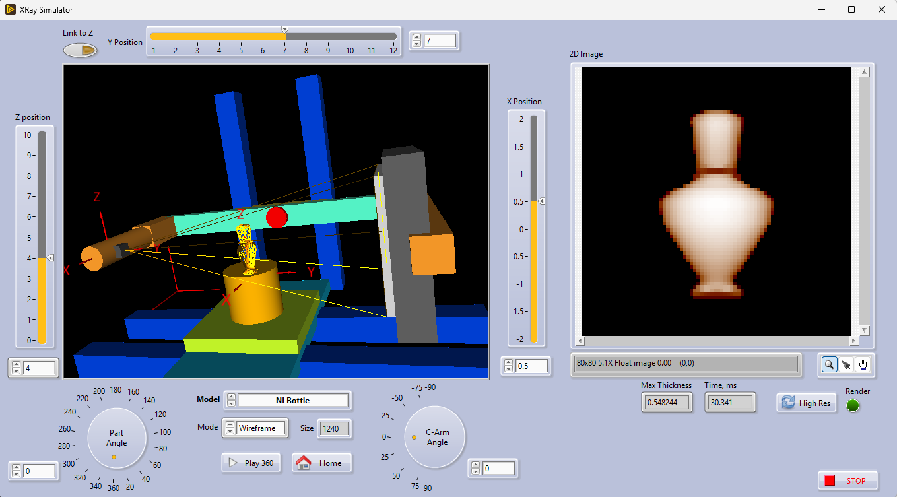

# Halloween 2026 in Rust

Single-crate Rust app (edition 2024, eframe/egui 0.31). All code lives in one `src/main.rs` on purpose — keep it a single file.
Industrial-style C-arm X-ray inspector: CPU rays (Möller–Trumbore over a uniform voxel grid) through a static procedurally-generated pumpkin mesh; model rotation is applied to the *rays* so the accel structure is built once. Hollow cavity + seeds + carved jack-o'-lantern face (Carving: convex triangle prisms subtracted from the flesh between body and cavity crossings). Air = maximal intensity, material darker.
- **Ray stamp is per ray, not per frame** (`sc.stamp += 1` inside the pixel loop). A per-frame stamp makes every ray after the first silently skip triangles → blank X-ray. Don't move it.
- Mesh hit dedup: shared-edge neighbor triangles yield near-duplicate t hits; `dedupe_hits` (1e-3) then chords are taken as entry..exit *span* (odd hit counts from rib grooves can't drop the chord). Don't revert to even/odd pairing.
- Detector mapping: pixel x → world z (rotates with model), pixel y → world y flipped so the stem points up. The model "front" (carved face) points at −X, toward the source, so features read crisply.
- Perf: debug builds are far too slow; use `cargo run --release`. The detector render is throttled adaptively (`det_ms`) so debug stays usable; cost scales with the detector resolution selector (default 192 px).
- **WASM clock: never use `std::time::Instant` directly** — it panics on wasm32-unknown-unknown ("time not implemented on this platform"), which leaves the web page stuck on "Loading". The `Instant` shim at the top of main.rs routes to `performance.now()` on web; extend it (not `std`) if more clock API is needed.
- **WASM timing: `trunk serve` builds dev-profile wasm**, where the first full detector render stalls the page for minutes. `Trunk.toml` pins `[build] release = true`, so plain `trunk build`/`trunk serve -p 8082` are release — don't remove it.
- Visual regression: `cargo test --release dump_xray_frame_png -- --ignored --nocapture` writes `target/xray_frame.png` + a block-mean map to stdout (needs the `image` dev-dep). Inspect it after changing geometry, carving shapes, or the film response.

## GUI and Algorithm
Simple C-Arm X-ray system: source on the left, 2D square detector on the right.
- The 3D model (Halloween Pumpkin) is slowly rotated; the X-ray image rotates accordingly.
- Rays are intersected with the triangles via the Müller–Trumbore algorithm.
- Intensity is proportional to material crossed by the ray: **air = maximal intensity, material = less intensity**.

## WASM and Desktop
- Desktop: `cargo run --release` (default features).
- WASM via trunk (root `index.html` exists; canvas element is created at runtime by `main()`):
  - `trunk build --release --public-url . --no-default-features`
  - `trunk serve -p 8082`
- The `native` default feature only adds unix windowing backends (`eframe/x11`, `eframe/wayland`); `--no-default-features` for WASM keeps that wiring deliberate.
- Verification: `cargo test` (2 tests cover chord lengths of the mesh tracer); `cargo check --target wasm32-unknown-unknown --no-default-features` for the web target.
